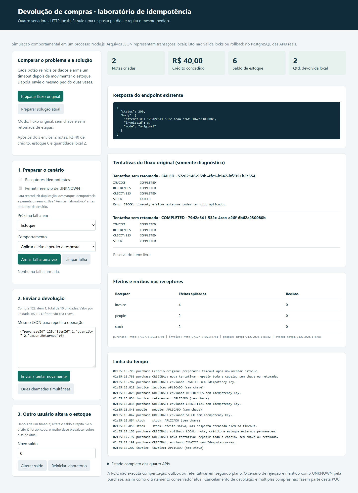
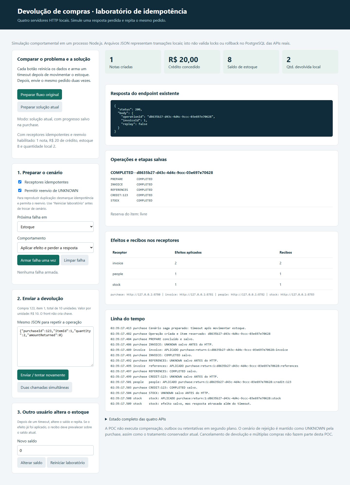
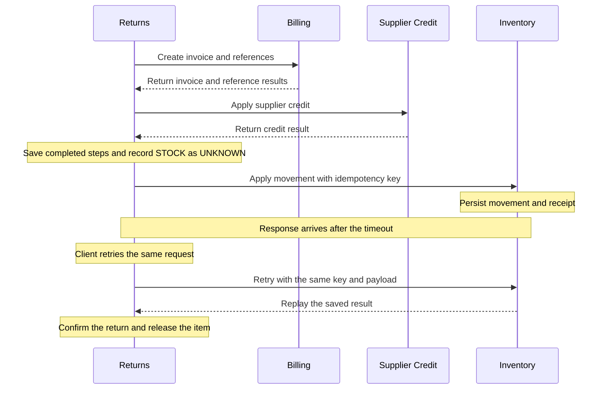

# Purchase Return Idempotency POC

A local Node.js lab for comparing two ways to retry a purchase return after an API timeout. Both modes simulate the same failure: Inventory applies the stock movement, but the response arrives after the caller's timeout.

In the original flow, the second request starts the entire chain again. In the idempotent flow, Returns reuses the completed steps and retries Inventory with the same key.

## Run locally

Use **Node.js 20 or later**. From the repository root, run:

```sh
node server.js
```

Open [http://127.0.0.1:8780](http://127.0.0.1:8780). The lab starts four HTTP servers on loopback in one Node.js process.

| Service | Default port | Responsibility |
| --- | ---: | --- |
| Returns | 8780 | Accept the return, coordinate the calls, and confirm the result locally |
| Billing | 8781 | Create the invoice and its references |
| Supplier Credit | 8782 | Apply credit to the supplier |
| Inventory | 8783 | Apply the stock movement |

To use a different range, set `POC_BASE_PORT` before starting the server. The remaining services use the next three ports.

```powershell
$env:POC_BASE_PORT = '8880'
node server.js
```

Press **Ctrl+C** to stop the servers. Progress and receiver receipts are stored in `.data/` and survive a restart. Use **Reiniciar laboratório** in the UI to reset the simulation.

## Compare the two modes

The UI labels are in Portuguese. The default request returns two units from purchase `123` at R$10 per unit, starting with 10 units in stock.

1. Click **Preparar fluxo original** (prepare original flow). This resets the lab and schedules a timeout after Inventory applies the movement.
2. Click **Enviar / tentar novamente** (send or retry). The first request times out after the invoice, credit, and stock movement have been applied. The local returned quantity stays at zero.
3. Send the same request again. The original flow starts over and applies those remote effects again.
4. Click **Preparar solução atual** (prepare current solution) and send the same request twice. This runs the same failure with persisted progress and idempotent receivers enabled.

| Result after the second request | Original flow | Idempotent flow |
| --- | ---: | ---: |
| Invoices created | 2 | 1 |
| Supplier credit applied | R$40 | R$20 |
| Remaining stock | 6 | 8 |
| Quantity confirmed locally | 2 | 2 |

<details>
<summary>Original flow after the retry</summary>



</details>

<details>
<summary>Idempotent flow after the retry</summary>



</details>

## How recovery works

The client calls `POST /purchases/itens/return` with the same request body on each attempt. In saga mode, Returns identifies equivalent requests from their business fields and generates a stable `Idempotency-Key` for each remote write.



Before making a remote call, Returns saves the step as `UNKNOWN`. When it receives a successful response, it saves the result as `COMPLETED`. On retry, it skips completed steps. The receiver checks for a matching receipt before applying a new effect. If the same key arrives with a different payload, it returns `409`.

## Try other failures

- **Timeout before the effect.** Arm an Inventory failure before execution, set stock to zero after the timeout, and retry. Inventory rejects the new execution because there is no saved receipt to replay.
- **Stock changes after the effect.** Arm a timeout after the movement, set stock to zero, and retry. Inventory returns the saved result and the return can finish.
- **Failure during local confirmation.** Arm a failure in Returns after the remote effects. The retry reuses the completed steps and attempts local confirmation again.
- **Concurrent calls.** Use **Duas chamadas simultâneas** to see one request execute while the other receives a conflict.
- **Blocked recovery.** Disable **Permitir reenvio de UNKNOWN** to see the return remain pending when a remote outcome is unknown.

Run the automated simulations with:

```sh
node --test simulation.test.js
```

The lab uses separate JSON files to model each service's state and the joint commit of an effect and its receipt. It demonstrates HTTP retry behavior. Database locking and rollback in PostgreSQL require separate integration tests. Recovery is triggered by another request, and compensation remains outside the simulation.
